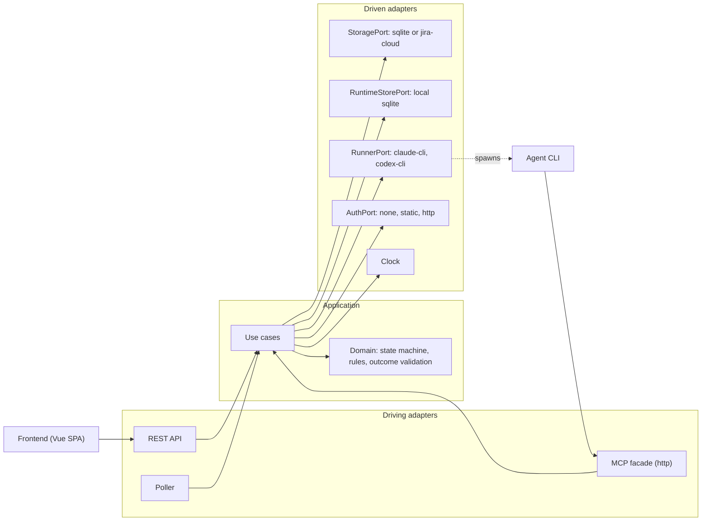
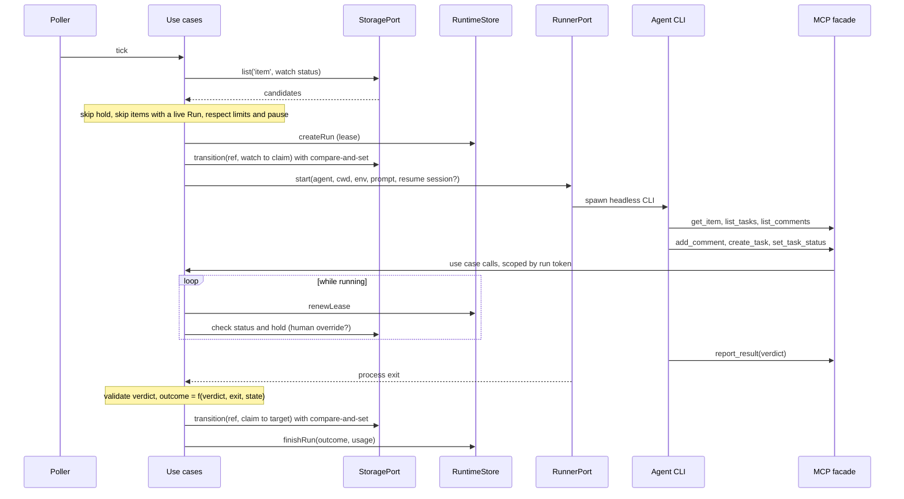
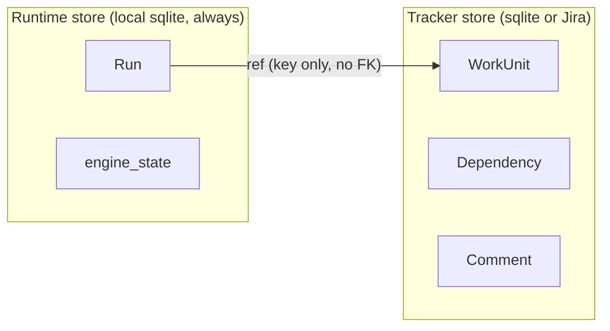

# Architecture

## 目標

- 一個後端 engine 定時檢查 tracker，命中規則就派 agent 做事，結果寫回。
- tracker 可抽換：沒有 Jira 也能用 sqlite 在本機跑。選哪個就只看哪個，不同步。
- 規則、status 對照、agent 都在一份 config 裡，使用者不用寫 API。
- 前端只是 API 的一個 client，在 sqlite 模式下用來看進度與操作。

不做的事見 plan.md 的 non-goals。

## 分層

Clean Architecture / ports and adapters。Domain 不認識 Jira、sqlite、claude。



要點：

- 狀態轉移、權限、驗證只寫在 use case 與 domain 一處，REST、MCP、Poller 進來都過同一關。
- port 的介面定義在 application 層，adapter 去實作它。
- 真正需要寫成程式介面的只有三個：Storage、Runner、Auth，它們也是 plugin 的三個角色（D44）。RuntimeStore 是 engine 內部的 port，不開放給 plugin。stage 是 config，model 是 agent 的參數，前端是 API 的 client。
- 所有用到現在時間的地方都從 `Clock` 拿，不直接呼叫 `Date.now()`。

## Ports

草稿，簽名之後以程式碼為準。adapter 的建構子注入 `Clock`，`createdAt`、`finishedAt`、`cancelRequestedAt` 這類時間由 adapter 蓋章，use case 只傳業務欄位。

```ts
interface StoragePort {
  list(kind: Kind, status: string): Promise<WorkUnit[]>
  get(ref: Ref): Promise<WorkUnit>
  children(item: Ref): Promise<WorkUnit[]>
  dependencies(item: Ref): Promise<Dependency[]>
  comments(target: Ref): Promise<Comment[]>
  // compare-and-set: throws StatusConflict if current status != expectedFrom
  transition(ref: Ref, expectedFrom: string, to: string, actor: Actor): Promise<void>
  addComment(c: NewComment): Promise<void>
  createTask(item: Ref, t: NewTask): Promise<WorkUnit>
  updateTask(ref: Ref, patch: TaskPatch): Promise<void>
  setLabels(ref: Ref, labels: string[]): Promise<void>
}

interface Clock {
  now(): Date
}

interface RuntimeStorePort {
  createRun(r: NewRun): Promise<Run>          // fails if target already has a live Run; the store assigns id and logPath
  renewLease(id: string, until: string, lastActivityAt: string): Promise<void>
  finishRun(id: string, outcome: Outcome, usage?: Usage): Promise<void>
  requestCancel(id: string, mode: 'soft' | 'hard', by: Actor): Promise<void>   // idempotent, hard upgrades soft
  bumpProduced(id: string, key: 'questions' | 'tasks'): Promise<void>
  liveRuns(): Promise<Run[]>
  runsFor(target: Ref): Promise<Run[]>        // newest first
  getState(key: string): Promise<string | undefined>   // e.g. 'paused'
  setState(key: string, value: string): Promise<void>
}

interface RunnerPort {
  start(spec: RunSpec): RunHandle    // spawn headless CLI, returns handle
}
interface RunHandle {
  readonly sessionId: Promise<string | undefined>
  readonly exit: Promise<{ code: number | null; signal: string | null }>
  terminate(grace: 'soft' | 'hard'): Promise<void>
}

interface AuthPort {
  login(credentials: unknown): Promise<Identity>
  verify(sessionToken: string): Promise<Identity | undefined>
}
```

## 一次規則執行



順序刻意是「先建 Run（lease）、再轉 claim status」。中間當機的話，只會留下一個會過期的 Run，item 還在原本的 status，不會卡住。

## 兩個 store



Jira 模式下 ticket 在 Jira，Run 在本機，兩邊靠 key 互指。

## 部署形態

| | local | cloud |
|---|---|---|
| 怎麼跑 | npm CLI，一個 process | container image |
| agent 認證 | 沿用使用者已登入的 claude / codex CLI | API key |
| tracker | sqlite 或 Jira | 通常 Jira |
| 登入 | 預設不登入，只綁 127.0.0.1 | 設 auth，或放在反向代理後面 |
| 單 instance | 是 | 是（多 instance 還沒決定，見 plan.md） |

## 暫定技術棧

最後才確認，目前傾向：

- 語言：TypeScript，Node。
- engine：單一 monolith process，同時 serve REST、MCP、靜態前端。
- 前端：Vue 3 + Vite SPA，打包成靜態檔由 engine serve。不用 Nuxt，因為是 API 後面的管理介面，不需要 SSR。
- repo：pnpm workspace。
- 工具鏈：Vite+（`vp`），lint、format、type check、測試、build 都走它，見 D27、D28。library 用 `vp pack`（tsdown）打包。

```
packages/
  core/         domain + application (ports live here), no I/O. The public contract for plugins
  testkit/      contract tests that every tracker / runner / auth plugin has to pass
  sqlite/       tracker plugin
  jira-cloud/   tracker plugin
  claude-cli/   runner plugin
  codex-cli/    runner plugin
  auth/         none, static, http
  server/       composition root, REST, MCP facade, Poller, plugin loader, config loading,
                runtime store (sqlite)
  web/          Vue 3 + Vite SPA
  cli/          init, doctor, start
```

一個技術一個套件，載入方式與契約見 plugins.md（D44）。runtime store 是 engine 自己的狀態，不是 plugin，放在 `server`，所以 Jira 模式下 `sqlite` 套件不是必裝。`auth` 內建實作怎麼分套件還沒定，見 plugins.md。

`core/src` 的內部分法（D40）：分 `domain/` 與 `application/`，`application/` 再分 `ports/`、`use-cases/`、`config/`。目錄隨切片長出來，不預先建空殼。

- `domain/` 只放業務概念與規則，不 import `application`。檔案依概念命名（`work-unit.ts`、`run.ts`），不放 `types.ts`。
- `ports/` 放介面與 adapter 會丟的錯誤，`use-cases/` 一個檔案一個 use case。
- 依賴只往內：`ports` 不 import `use-cases`，use case 之間不互相 import。

sqlite 用 Node 內建的 `node:sqlite`，不另外裝 driver（D42）。schema 用 append-only 的 migration，版本記在 `PRAGMA user_version`。server 用 Hono，web 是 Vue 3 + Vite SPA，開發時由 Vite 把 `/api` proxy 到 server。
