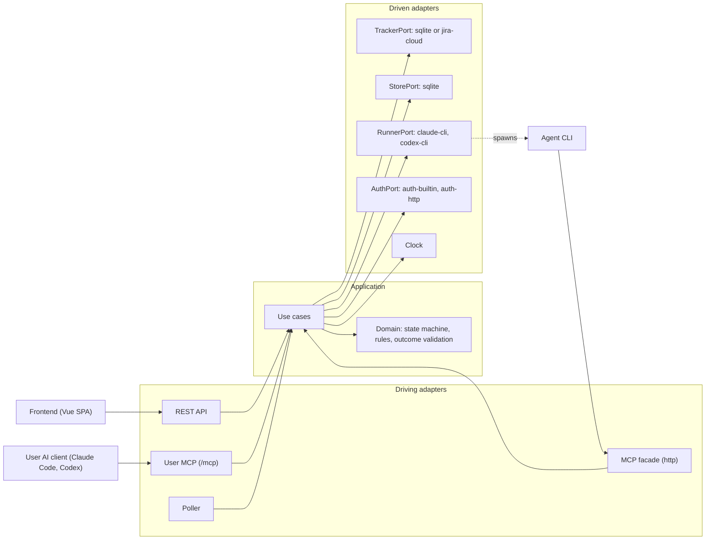
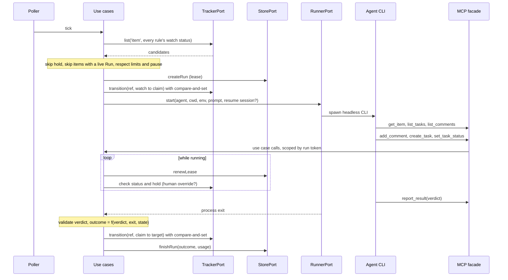
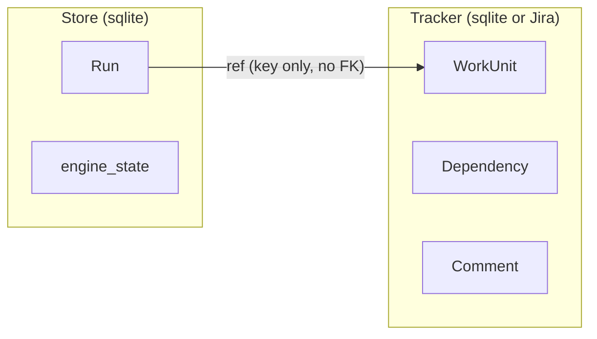

# Architecture

## 目標

- 一個後端 engine 定時檢查 tracker，命中規則就派 agent 做事，結果寫回。
- tracker 可抽換：沒有 Jira 也能用 sqlite 在本機跑。選哪個就只看哪個，不同步。
- 規則、status 對照、agent 都在一份 config 裡，使用者不用寫 API。
- 前端只是 API 的一個 client，在 sqlite 模式下用來看進度與操作。

不做的事見 plan.md 的 non-goals。

## 分層

Clean Architecture / ports and adapters。Domain 不認識 Jira、sqlite、claude。



要點：

- 狀態轉移、權限、驗證只寫在 use case 與 domain 一處，REST、MCP、Poller 進來都過同一關。
- MCP 有兩個入口：MCP facade 給 engine 派出的 agent，帶 run token，只能碰被派的那張 item；使用者 MCP（`/mcp`）給使用者自己的 AI client，身分是使用者，能做的事跟看板一樣（D57）。
- port 的介面定義在 application 層，adapter 去實作它。
- 真正需要寫成程式介面的是 Tracker、Store、Runner、Auth，它們也是 plugin 的四個角色（D44、D88）。stage 是 config，model 是 agent 的參數，前端是 API 的 client。
- 所有用到現在時間的地方都從 `Clock` 拿，不直接呼叫 `Date.now()`。

## Ports

草稿，簽名之後以程式碼為準。adapter 的建構子注入 `Clock`，`createdAt`、`finishedAt`、`cancelRequestedAt` 這類時間由 adapter 蓋章，use case 只傳業務欄位。

TrackerPort 的每個方法各自生效，兩次呼叫之間沒有 transaction。Jira 做不到跨呼叫的原子性，所以 sqlite adapter 也不提供，use case 不能假設一連串寫入「全成功或全失敗」，中途失敗後重跑要能接著做（D47）。

`list` 可能比寫入晚幾秒才反映出來。Jira 的 `list` 走搜尋索引，實測建完 338ms 搜不到、1740ms 搜得到；`get` 與寫入本身是即時的。剛寫完的呼叫端要用寫入回傳的結果，不要馬上重新 `list`。Poller 下一輪自然會讀到，認領用的 compare-and-set 直接讀那張 issue，不受影響（D54）。

```ts
interface TrackerPort {
  list(kind: Kind, statuses: readonly string[]): Promise<WorkUnit[]>  // one query for all of them
  get(ref: Ref): Promise<WorkUnit>            // throws NotFound
  children(item: Ref): Promise<WorkUnit[]>
  dependencies(item: Ref): Promise<Dependency[]>
  comments(target: Ref): Promise<Comment[]>
  createItem(i: NewItem): Promise<WorkUnit>
  // compare-and-set: throws StatusConflict (with the unit as it is now) if current status != expectedFrom
  transition(ref: Ref, expectedFrom: string, to: string): Promise<WorkUnit>
  addComment(c: NewComment): Promise<Comment>
  // compare-and-set on version: throws EditConflict (with the unit as it is now)
  updateItem(ref: Ref, expectedVersion: string, patch: ItemPatch): Promise<WorkUnit>
  attachments(target: Ref): Promise<Attachment[]>
  addAttachment(target: Ref, a: NewAttachment): Promise<Attachment>
  readAttachment(target: Ref, id: string): Promise<{ attachment: Attachment; data: Uint8Array }>
  deleteAttachment(target: Ref, id: string): Promise<void>
  // children and dependencies see a task the moment it exists, unlike list: verdicts are checked against them
  createTask(item: Ref, t: NewTask): Promise<WorkUnit>   // throws InvalidInput when blockedBy is not a task of item
  deleteTask(ref: Ref): Promise<void>         // with its dependencies either way and comments; the ref is never reused (D70)
  deleteItem(ref: Ref): Promise<void>         // with all its tasks, comments and attachments (D74)
  addLabel(ref: Ref, label: string): Promise<WorkUnit>     // one label only, leaves the version alone (hold, D72)
  removeLabel(ref: Ref, label: string): Promise<WorkUnit>
  updateTask(ref: Ref, patch: TaskPatch): Promise<void>
  setLabels(ref: Ref, labels: string[]): Promise<void>
  // Optional: the statuses a unit of this kind can be in, for a tracker with a fixed set (Jira).
  // The settings page picks keys from it, and a save is refused on a key outside it (D91).
  listStatuses?(kind: Kind): Promise<{ key: string; name: string }[]>
}

interface Clock {
  now(): Date
}

// A plugin role like the tracker (D88); every store passes testkit's store contract.
// The comments are what later slices add.
interface StorePort {
  createRun(r: NewRun): Promise<Run>          // throws RunConflict if target already has a live Run; the store assigns the id
  getRun(id: string): Promise<Run>
  renewLease(id: string, leaseSeconds: number): Promise<void>
  touch(id: string): Promise<void>            // lastActivityAt = now (D34)
  recordSession(id: string, sessionId: string): Promise<void>
  report(id: string, verdict: Verdict, summary: string): Promise<void>   // first report only
  bumpProduced(id: string, key: 'questions' | 'tasks'): Promise<void>
  finishRun(id: string, outcome: Outcome): Promise<void>                  // + usage
  liveRuns(): Promise<Run[]>
  runsFor(target: Ref): Promise<Run[]>        // newest first
  latestRunsEndedIn(outcome: Outcome): Promise<Run[]>   // newest Run per target, if it ended so (auto-resume, D71)
  requestCancel(id: string, mode: CancelMode, by: CancelReason): Promise<void>  // first time stays; a hard one upgrades soft and its reason wins (D73)
  isPaused(): Promise<boolean>                // the global pause, kept in engine_state (D73)
  setPaused(paused: boolean): Promise<void>
  // The flow settings as opaque JSON, every save a new version; the engine checks them (D91).
  latestFlow(): Promise<FlowVersion | undefined>          // undefined before the first save
  saveFlow(expected: number | undefined, flow: unknown, savedBy: string): Promise<FlowVersion>  // throws FlowConflict if not the latest
  flowHistory(): Promise<FlowVersion[]>                   // every save, newest first (W4b)
}

interface RunnerPort {
  start(spec: RunSpec): RunHandle    // spawn headless CLI, returns handle
}
interface RunSpec {
  runId: string
  target: Ref
  mode: 'split' | 'execute' | 'rework' | 'review'
  workspace: string                  // created by the engine, the agent's cwd
  mcp: { url: string; token: string }   // the MCP facade, bound to this Run
  prompt: string                     // the engine's contract and the rule's template, variables filled in
  resume?: string                    // session to pick up (per-item); the runner falls back to a new one
  logPath: string                    // <dataDir>/logs/<runId>.log, named by the engine; the runner writes the agent's output here
  onActivity(): void                 // output seen: lastActivityAt (D34)
  onSession(id: string): void        // the session this Run is in, kept on the Run
}
interface RunHandle {
  readonly exit: Promise<{ code: number | null; signal: string | null }>
  terminate(signal: 'SIGTERM' | 'SIGKILL'): void   // the whole process tree; the engine times the grace (D72)
}

interface AuthPort {
  login(credentials: unknown): Promise<Identity>
  verify(sessionToken: string): Promise<Identity | undefined>
}
```

## 一次規則執行



順序刻意是「先建 Run（lease）、再轉 claim status」。中間當機的話，只會留下一個會過期的 Run，item 還在原本的 status，不會卡住。

## 兩個 store



Jira 模式下 ticket 在 Jira，Run 在 store，兩邊靠 key 互指。tracker 與 store 是兩個 plugin、兩個檔案，各自可換。Run 的 log 不在 store，是 engine 那台機器上的檔案。

## 部署形態

| | local | cloud |
|---|---|---|
| 怎麼跑 | npm CLI，一個 process | container image |
| agent 認證 | 沿用使用者已登入的 claude / codex CLI | API key |
| tracker | sqlite 或 Jira | 通常 Jira |
| 登入 | 預設不登入，只綁 127.0.0.1 | 設 auth，或放在反向代理後面 |
| 單 instance | 是 | 是，一個 tracker project 一個 engine（D66） |

## 暫定技術棧

最後才確認，目前傾向：

- 語言：TypeScript，Node。
- engine：單一 monolith process，同時 serve REST、MCP、靜態前端。
- 前端：Vue 3 + Vite SPA，打包成靜態檔由 engine serve。不用 Nuxt，因為是 API 後面的管理介面，不需要 SSR。元件用 Nuxt UI（在純 Vue + Vite 底下用，不需要 Nuxt），見 D56。字型是 Bricolage Grotesque，用 `@fontsource-variable` 打包進 bundle，不連 Google Fonts，公司內網也能用（D79）。
- repo：pnpm workspace。
- 工具鏈：Vite+（`vp`），lint、format、type check、測試、build 都走它，見 D27、D28。`.vue` 的 template 型別檢查另外用 vue-tsc（配 `web` 自己的 TS 6），見 D58；git hook 走 `vp config` 與 `vp staged`，見 D53。library 用 `vp pack`（tsdown）打包。

```
packages/
  core/         domain + application (ports live here), no I/O. The public contract for plugins
  testkit/      contract tests that every tracker / store / runner / auth plugin has to pass
  sqlite/       tracker and store plugin
  jira-cloud/   tracker plugin
  claude-cli/   runner plugin
  codex-cli/    runner plugin
  fake-runner/  runner plugin that stands in for an agent, for trying the engine without an LLM
  auth-builtin/ auth plugin: accounts kept in the store
  auth-http/    auth plugin: asks an external API
  server/       composition root, REST, MCP facade (/agent-mcp), user MCP (/mcp), engine
                (Poller and Run supervision), plugin loader, config loading, doctor (D95)
  web/          Vue 3 + Vite SPA
  cli/          init, doctor, start
```

一個技術一個套件，載入方式與契約見 plugins.md（D44）。store 預設是 `sqlite`，所以 Jira 模式下也要裝 `sqlite`，除非換成別的 store plugin（D88）。auth 的內建實作分成 `auth-builtin` 與 `auth-http`，不登入是省略 `auth`（D89）。

測試用的東西照「誰在用它」分兩種，不合成一包：

- 測試 import 的放進 `testkit`。新的 port 契約（runner、auth）就在這裡加一組 `describeXxxContract`，不另開套件。它依賴測試框架，只能當 devDependency。
- 給 config 載入的假 plugin 一個角色一包，和真的 plugin 並排，例如 `fake-runner`。它走跟真 plugin 同一條載入路徑（D44），runtime 不能帶到測試框架。tracker 有 `sqlite` 可以當假的用，不另做。
- `core/src/testing` 的 stub 只給 core 自己的單元測試用。它不能搬進 `testkit`，因為 `testkit` 依賴 `core`，搬過去會循環依賴。

`core/src` 的內部分法（D40）：分 `domain/` 與 `application/`，`application/` 再分 `ports/`、`use-cases/`、`config/`。目錄隨切片長出來，不預先建空殼。

- `domain/` 只放業務概念與規則，不 import `application`。檔案依概念命名（`work-unit.ts`、`run.ts`），不放 `types.ts`。
- `ports/` 放介面與 adapter 會丟的錯誤，`use-cases/` 一個檔案一個 use case。
- 依賴只往內：`ports` 不 import `use-cases`，use case 之間不互相 import。

sqlite 用 Node 內建的 `node:sqlite`，不另外裝 driver（D42）。schema 用 append-only 的 migration，版本記在 `PRAGMA user_version`。server 用 Hono，web 是 Vue 3 + Vite SPA，開發時由 Vite 把 `/api` proxy 到 server。
