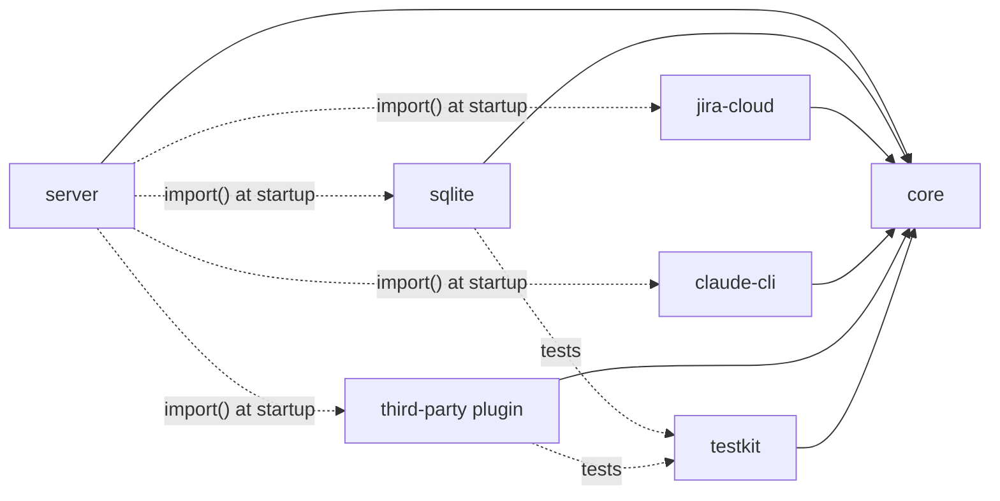

# Plugins

狀態：草稿。只有方向確認（見 D44），形狀與欄位都還沒定，下面「待定」一節列出缺什麼。

tracker、runner、auth 三個角色都可以由第三方寫成 npm 套件。內建的 sqlite、Jira Cloud、claude-cli、codex-cli 與第三方走同一條路，內建的沒有任何第三方拿不到的東西。

## 確認的方向

- plugin 是 in-process 的 npm 套件，與 engine 同一個 process。不做獨立 process 加協定的版本。
- 三個角色：tracker（對應 StoragePort）、runner（RunnerPort）、auth（AuthPort）。一個套件可以提供一個以上的角色。
- RuntimeStore 不是 plugin。它是 engine 自己的狀態，放在 `server`。
- 一個技術一個套件：`sqlite`、`jira-cloud`、`claude-cli`、`codex-cli`。不按角色切，因為同一個技術可能同時提供多個角色。
- `core` 是公開契約。plugin 只相依 `core`，不 import `server` 或其他 plugin。ports 與它們引用的型別都是公開 API，改簽名是 breaking change。
- `testkit` 提供契約測試。內建與第三方的實作都要通過同一組。
- plugin 宣告 `apiVersion`，engine 載入時檢查。
- plugin 是受信任的程式碼，沒有沙箱，見 security-and-auth.md。

## 套件關係

實線是編譯時的相依，虛線是執行時才載入或只在測試用到。`server` 不在編譯時相依任何 plugin。

## 待定

這些文件裡完全沒有，也沒有被確認過，實作前要先問作者。

1. plugin 匯出的物件長什麼樣子：怎麼宣告提供哪些角色、怎麼建立實例、拿到哪些東西（Clock、logger）。
2. config 怎麼指定要用哪個 plugin，以及 plugin 自己的 options 放哪裡。
3. plugin 的 options 怎麼驗證，以及 JSON Schema 由誰提供給編輯器補全。
4. `doctor` 怎麼把檢查委派給 plugin（Jira 的 workflow 轉移檢查、CLI preflight 都是 plugin 才知道的事）。
5. `apiVersion` 的相容規則：完全相等，還是 semver 範圍。
6. 第三方套件的命名慣例。
7. `auth` 的三個內建實作怎麼分套件。
8. plugin 載入失敗時 engine 的行為：拒絕啟動，還是跳過並報警。
9. plugin 的錯誤怎麼回報成 `system` comment 或 log，哪些資訊不能外洩（secret）。
