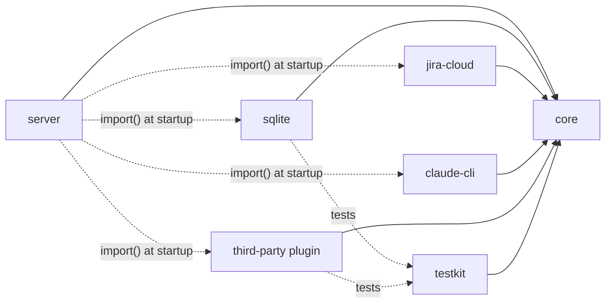

# Plugins

狀態：草稿。方向已確認（D44），匯出形狀、config 寫法、載入失敗的行為已確認（D48），其餘列在「待定」。

tracker、runner、auth 三個角色都可以由第三方寫成 npm 套件。內建的 sqlite、Jira Cloud、claude-cli、codex-cli 與第三方走同一條路，內建的沒有任何第三方拿不到的東西。

## 確認的方向

- plugin 是 in-process 的 npm 套件，與 engine 同一個 process。不做獨立 process 加協定的版本。
- 三個角色：tracker（對應 StoragePort）、runner（RunnerPort）、auth（AuthPort）。一個套件可以提供一個以上的角色。
- RuntimeStore 不是 plugin。它是 engine 自己的狀態，放在 `server`。
- 一個技術一個套件：`sqlite`、`jira-cloud`、`claude-cli`、`codex-cli`。不按角色切，因為同一個技術可能同時提供多個角色。
- `core` 是公開契約。plugin 只相依 `core`，不 import `server` 或其他 plugin。ports 與它們引用的型別都是公開 API，改簽名是 breaking change。
- `testkit` 提供契約測試。內建與第三方的實作都要通過同一組。
- plugin 宣告 `apiVersion`，engine 載入時檢查。
- plugin 是受信任的程式碼，沒有沙箱，見 security-and-auth.md。

## 套件關係



實線是編譯時的相依，虛線是執行時才載入或只在測試用到。`server` 不在編譯時相依任何 plugin。

## 匯出形狀

套件的 default export 是 `core` 提供的 `definePlugin(...)` 的結果。每個角色是一個工廠函式，engine 呼叫它建立實例。簽名細節以程式碼為準。

```ts
// packages/sqlite/src/index.ts
export default definePlugin({
  name: '@tasuki/sqlite',
  apiVersion: 1,
  tracker: (ctx, options) => createSqliteTracker(ctx, options),
})
```

- 有提供的角色才寫那個 key（`tracker`、`runner`、`auth`），一個套件可以寫多個。
- `ctx` 是 engine 注入的東西：`Clock`、解析成絕對路徑的 `dataDir`、`statuses`（邏輯名與 tracker 端 status key 的雙向對照）。plugin 不自己取時間，也不自己決定資料放哪裡。port 進出的 status 一律是邏輯名，翻成 tracker 的 key 是 plugin 的事。logger 等第一個需要它的切片再加。
- `options` 是 config 裡該 plugin 的 `options`，`${VAR}` 已經展開。
- 工廠用函式而不是 class，因為注入點就是參數，第三方不用繼承 `core` 的任何東西。

## config 怎麼指定

config 用 npm 套件名指定 plugin，engine 從 config 所在的資料夾解析套件（跟那個資料夾的專案解析自己的相依一樣），再用 `import()` 載入。plugin 自己的設定放在同一層的 `options`，engine 不看內容，原封不動交給工廠。

```jsonc
"tracker": {
  "plugin": "@tasuki/jira-cloud",
  "options": { "baseUrl": "https://example.atlassian.net", "apiToken": "${JIRA_API_TOKEN}" }
}
```

`statuses` 不放進 `options`。規則比對與自動復原是 engine 在讀邏輯名，不是 tracker 私有的設定。

## 載入失敗

套件找不到、default export 不是 `definePlugin` 的結果、`apiVersion` 不相容、缺少 config 要求的角色、工廠丟錯，任何一種都拒絕啟動，錯誤訊息指出是哪個 plugin、哪一步。不跳過，因為少了 tracker 或 runner，engine 沒有任何事可做，跳過只會讓人以為它在跑。

## 待定

這些文件裡完全沒有，也沒有被確認過，實作前要先問作者。

1. plugin 的 options 怎麼驗證，以及 JSON Schema 由誰提供給編輯器補全。
2. `doctor` 怎麼把檢查委派給 plugin（Jira 的 workflow 轉移檢查、CLI preflight 都是 plugin 才知道的事）。
3. `apiVersion` 的相容規則：完全相等，還是 semver 範圍。程式目前要求完全相等。
4. 第三方套件的命名慣例。
5. `auth` 的三個內建實作怎麼分套件。
6. plugin 的錯誤怎麼回報成 `system` comment 或 log，哪些資訊不能外洩（secret）。
