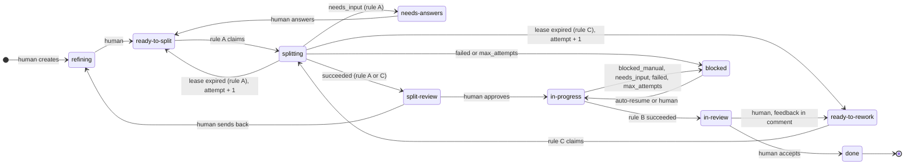
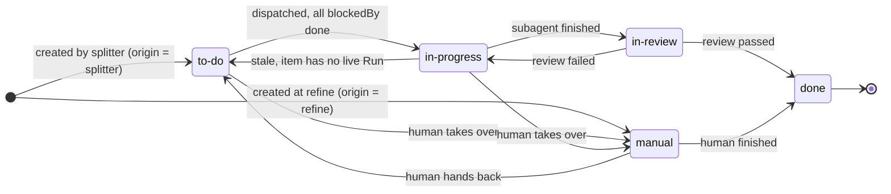

# State machine (item / task)

狀態名是 config 裡的邏輯名（kebab-case）。顯示名是 Title Case（`ready-to-split` 顯示成 `Ready to Split`）。
Jira / sqlite 的實際名稱靠 config 的 status mapping 對應，這份文件不管實際名稱。

名詞以 glossary.md 為準，欄位細節以 data-model.md 為準。

## Item

人可以把 item 從任何狀態移到任何狀態。特別注意 `blocked` 的出口不限於 `in-progress`，補完資料後可以直接拉去 `ready-to-rework`。

### Auto-resume (`blocked` -> `in-progress`)

三個條件同時成立，engine 才自動接回：

1. 最近一次 Run 的 outcome 是 `blocked_manual`
2. 擋住的 manual task 都已經 `done`
3. item 沒有 `hold`

### Rules and outcomes

| rule | watch | claim status | succeeded | needs_input | blocked_manual | failed / max_attempts |
|---|---|---|---|---|---|---|
| A split | ready-to-split | splitting | split-review | needs-answers | n/a | blocked |
| B execute | in-progress | none (lease dedupes) | in-review | blocked | blocked | blocked |
| C rework | ready-to-rework | splitting | split-review | blocked | n/a | blocked |

- `cancelled` 的 Run 不動 status。item 停在原地，由人決定下一步。
- 規則 A 要能容忍 item 底下已經有 task（refine 階段建立的 manual task）。
- rework 的新 task 也要先過 `split-review`。想省掉這關，把規則 C 的 succeeded 出口改成 `in-progress`。

## Task

- `done` 是終點，engine 不重開。rework 一律開新 task。
- 目前 orchestrator 一個 item 起一個 process（M1），engine 看不到裡面的 subagent。把執行中的 task 改成 `manual` 只是 soft stop，之後不再派它。要立刻停掉那張 task，只能 hard stop 整個 orchestrator。
- task 層的「review 沒過重做幾次」engine 管不到，由 orchestrator 的 prompt 約束。item 層用 Run 的重試次數與用量設上限。

## Invariants

這六條之後直接變成測試。

1. 同一張 item 同時最多一個存活的 Run。
2. item 的 status 只有三種來源能改：人、規則的 outcome、自動復原。agent 不能改。
3. `in-progress` 的 task 只有在 item 有存活的 Run 時才可信。
4. `done` 的 task 不會被 engine 重開。
5. 有 `hold` 的 item，Poller 跳過它，存活的 Run 被取消。
6. `cancelled` 的 Run 不動任何 status。
