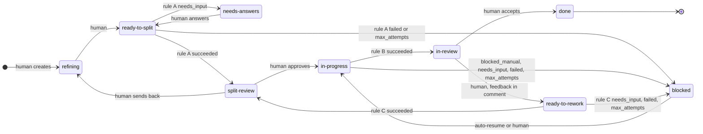
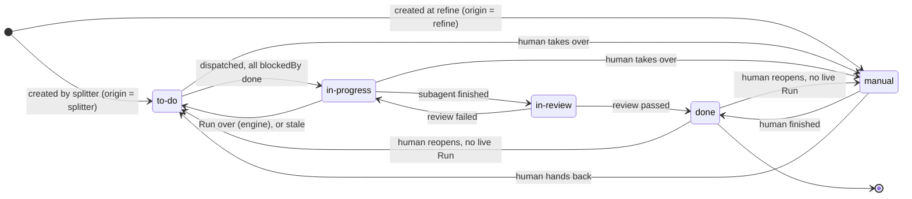

# State machine (item / task)

狀態名是 config 裡的邏輯名（kebab-case）。顯示名是 Title Case（`ready-to-split` 顯示成 `Ready to Split`）。
Jira / sqlite 的實際名稱靠 config 的 status mapping 對應，這份文件不管實際名稱。

名詞以 glossary.md 為準，欄位細節以 data-model.md 為準。

下面的十站是預設流程。站可以在 config 的 `workflow` 自己列，程式只認角色不認名字（D78、D81）：`entry` 是 `refining`、`failure` 是 `blocked`、`taskReview` 是 `split-review`、`rework` 是 `ready-to-rework`、`done` 是 `done`。這份文件寫到站名的地方，換了流程就讀成扮演那個角色的站。

## Item

預設規則都不設 claim status：agent 跑的時候 item 留在 watch status，卡片掛 Running，lease 防重複（D74）。`splitting` 是選用的 claim status，規則設了 `claim: splitting` 才用得到，那時 item 會先被移進 `splitting`，結束時從那裡走出口，lease 過期就送回該規則的 watch status。

人可以把 item 從任何狀態移到任何狀態。特別注意 `blocked` 的出口不限於 `in-progress`，補完資料後可以直接拉去 `ready-to-rework`。

### 誰處理

看板每欄標出這站誰處理（D68，D81 改名 `handledBy`）：

- engine：有規則 `watch` 這個 status，從 config 算，沒掛規則就不標。
- 人：站設了 `handledBy: "person"`。預設流程是 `needs-answers`、`split-review`、`in-review`、`blocked`，沒有規則會把 item 移出這幾欄。`blocked` 雖然有自動接回，前提是人先把 manual task 做完。
- 不標：兩者都沒有。預設流程是 `refining`（人自己在寫，不是在等確認）、claim status（卡片上已經有 Running）、`done`。

一站設了 `handledBy: "person"` 又被規則 watch 時，標 engine，因為 engine 會去撿。

人在詳情看到的決定按鈕是站上的 `outcomes`，按下去就是移到那一站。預設流程只有兩站有：`split-review` 是 `→ Refining` 與 `→ In Progress`，`in-review` 是 `→ Ready to Rework` 與 `→ Done`。按鈕字用中性的「箭頭加目標站」，不寫死批准、打回這類動作（D82）。

### Auto-resume (`blocked` -> `in-progress`)

三個條件同時成立，engine 才自動接回：

1. 最近一次 Run 的 outcome 是 `blocked_manual`
2. 擋住的 manual task 都已經 `done`：讀成 item 底下已經沒有任何 `manual` 的 task。人把 manual 交回 `to-do` 也算，下一個 Run 會去做它（D71）
3. item 沒有 `hold`

engine 每輪 poll 在復原之後、認領之前檢查，接回到那條規則的 watch status，並留一則 system comment（D67）。目標不寫死：item 要在那條規則 `outcomes.blocked_manual` 指的 status 上才接。

### Rules and outcomes

| rule | watch | claim status | succeeded | needs_input | blocked_manual | failed / max_attempts |
|---|---|---|---|---|---|---|
| A split | ready-to-split | none (lease dedupes) | split-review | needs-answers | n/a | blocked |
| B execute | in-progress | none (lease dedupes) | in-review | blocked | blocked | blocked |
| C rework | ready-to-rework | none (lease dedupes) | split-review | blocked | n/a | blocked |

- 表上是預設規則。每條規則的出口由它的 `outcomes` 決定，也可以宣告自己的結果，例如一條 `review` 規則的 `approve` 與 `changes`，item 照表去對應的站（config-and-rules.md，D84）。
- `cancelled` 的 Run 不動 status。item 停在原地，由人決定下一步。按 Stop 會順手貼上 `hold`，不然下一輪又會被認領（D72）。`hold` 拿掉後，停在 claim status 的 item 由 engine 送回 watch status，停在 watch status 的直接被 Poller 撿起。
- 規則 A 要能容忍 item 底下已經有 task（refine 階段建立的 manual task）。
- rework 要有人說改什麼才開跑：上一個 Run 結束之後，item 上要有一則人寫的 note。看板拖進 `ready-to-rework` 或從詳情移過去都會先問，使用者 MCP 的 `request_rework` 強制要寫；在 Jira 直接拖過去又沒留言的，engine 不派 agent，走規則的 `needs_input` 出口（預設 `blocked`）並留言請人補上（D75）。
- rework 的新 task 也要先過 `split-review`。想省掉這關，把規則 C 的 succeeded 出口改成 `in-progress`。

## Task

- engine 不重開 `done`，agent 也不行。rework 一律開新 task。
- 人走的邊：`to-do`、`in-progress` 接手成 `manual`，`manual` 交回 `to-do` 或做完成 `done`，按錯時把 `done` 改回 `to-do` 或 `manual`。改回去只在 item 沒有存活的 Run 時可以，agent 可能正依賴它是 done（D74）。不在這些邊上的移動拒絕（domain 的 `personMoveRefusal`）。
- 人在看板或使用者 MCP 的每個操作（移動 item 或 task、hold、release、Stop）都留一則 author 是人、kind 是 `system` 的 comment，例如「Moved **Manual** → **Done**.」（D82）。誰、什麼時候由 comment 本身記著。用 `system` 不用 `note`，因為 rework 的 agent 把人最新的 note 當成回饋（D74）。
- 人只能在 item 是 `split-review` 時改 task 的 title、body，或刪掉 task（D70）。
- 目前 orchestrator 一個 item 起一個 process（M1），engine 看不到裡面的 subagent。把執行中的 task 改成 `manual` 只是 soft stop，之後不再派它。要立刻停掉那張 task，只能 hard stop 整個 orchestrator。
- task 層的「review 沒過重做幾次」engine 管不到，由 orchestrator 的 prompt 約束。item 層用 Run 的重試次數與用量設上限。

## Invariants

這六條之後直接變成測試。

1. 同一張 item 同時最多一個存活的 Run。
2. item 的 status 只有三種來源能改：人、規則的 outcome、自動復原。agent 不能改。
3. `in-progress` 的 task 只有在 item 有存活的 Run 時才可信。Run 結束（`cancelled` 除外）或被 `abandoned` 時，engine 把它們送回 `to-do`（D69）。
4. `done` 的 task 不會被 engine 或 agent 重開。人可以，但只在 item 沒有存活的 Run 時（D74）。
5. 有 `hold` 的 item，Poller 跳過它，存活的 Run 被取消。
6. `cancelled` 的 Run 不動任何 status。
